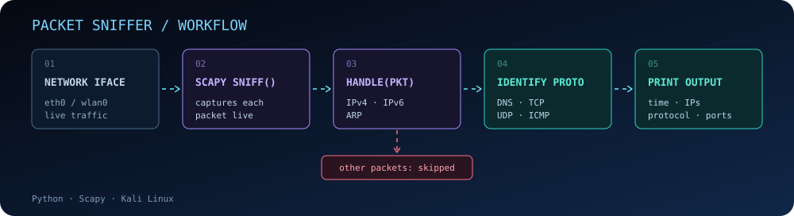

# Packet Sniffer

Python · Scapy · Kali Linux

A small command-line network packet sniffer that prints the source IP, destination IP, protocol, ports, and DNS queries of live traffic. I built it to understand how tools like Wireshark work under the hood.

---

## Requirements

- Python 3
- Scapy
- Root privileges (`sudo`), because capturing packets needs raw socket access

## Setup

```bash
sudo apt update && sudo apt install python3-scapy -y
```

or with pip:

```bash
pip3 install scapy
```

## Usage

Find your interface name first:

```bash
ip a
```

Then run:

```bash
sudo python3 sniffer.py -i eth0
```

Options:

| Option | Description |
|---|---|
| `-i`, `--iface` | Network interface to listen on (e.g. `eth0`, `wlan0`). If left out, Scapy picks one. |
| `-f`, `--filter` | Optional BPF filter, e.g. `icmp` or `port 80`. |

Example, capturing only ICMP (ping) traffic:

```bash
sudo python3 sniffer.py -i eth0 -f icmp
```

Press `Ctrl+C` to stop.

To try it, run the sniffer in one terminal and `ping -c 5 example.com` in another.

---

## Workflow



## What it does

- Captures live traffic with Scapy's `sniff()` without storing packets in memory
- Reads source and destination addresses from IPv4 and IPv6 packets
- Shows the protocol: TCP, UDP, ICMP, or DNS queries
- Shows source and destination ports for TCP and UDP
- Shows ARP requests and replies
- Skips packets it doesn't understand instead of crashing
- Prints a timestamp for every packet

## Example output

Addresses will differ on your network.

```text
Sniffing... press Ctrl+C to stop

[14:02:11] 10.0.2.15       -> 10.0.2.3        | DNS   (query: example.com.)
[14:02:11] 10.0.2.15       -> 93.184.216.34   | ICMP
[14:02:11] 93.184.216.34   -> 10.0.2.15       | ICMP
[14:02:12] 10.0.2.15       -> 142.250.190.46  | TCP   54321 -> 443
```

---

## Limitations

This is a learning project, not a production tool.

- Output goes to the terminal only. It does not save packets to a `.pcap` file.
- It does not inspect packet contents. HTTPS/TLS traffic is encrypted, so only the headers are visible.
- It only handles IP, IPv6, and ARP packets. Other packet types are skipped.
- It shows DNS queries only, not DNS responses.
- It is not an intrusion detection system and does not block, modify, or inject traffic.
- Scapy is written in Python, so it can fall behind on very busy networks.
- In a virtual machine, it only sees traffic that reaches the VM's network interface.
- There are no automated tests yet.

## Files

- `sniffer.py`: the sniffer and its command-line interface

## Ideas for improvement

- Save captured packets to a `.pcap` file
- Show a per-protocol packet count when stopping with `Ctrl+C`
- Add a simple port-scan detector
- Add automated tests

## Safe use

Only capture traffic on networks you own or have permission to monitor. Captured traffic can contain sensitive information, so handle it carefully.

